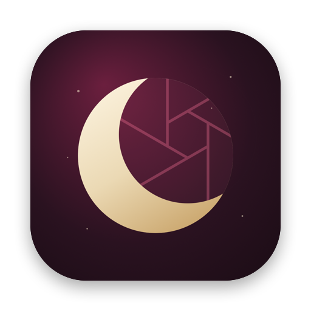

<!-- Luna | Project README -->

<div align="center">
  

  <h1>Luna</h1>
  <p><sub>Code-Name im Projekt: Lilith</sub></p>
  <p><strong>Deine Immich-Fotobibliothek. Nativ auf Apple-Geräten.</strong></p>
  <p>Eine native SwiftUI-App für den eigenen Immich-Server: Fotos ansehen, sortieren und automatisch vom iPhone sichern – im Stil von Apples Fotos-App.</p>

  <p>
    
    
    
    
  </p>

  <p>
    <a href="https://immich.app/">Immich kennenlernen</a>
    ·
    <a href="https://api.immich.app/">Immich API</a>
  </p>
</div>

---

## Was Luna ist

**Luna** ist eine native App für selbst gehostete [Immich](https://immich.app/)-Server. Deine Fotos und Videos bleiben auf deinem eigenen Server. Luna gibt dir dafür eine Oberfläche, die sich auf iPhone, iPad und Mac zu Hause fühlt, und sichert die Fotos deines iPhones automatisch.

Luna baut keine eigene Cloud und ersetzt keinen Immich-Server. Die App nutzt dessen Schnittstellen.

> Luna ist ein unabhängiges Community-Projekt und steht in keiner offiziellen Verbindung zum Immich-Team.

## Funktionen

| Bereich | Was Luna kann |
| --- | --- |
| **Anmeldung** | Serveradresse, Anmeldung mit Immich-Konto oder API-Schlüssel, Sitzung sicher im Schlüsselbund, App-Sperre mit Face ID |
| **Fotos** | Timeline wie in Apples Fotos-App: Neuestes unten, Raster ohne Lücken, flüssiges Zoomen von 1 bis 11 Spalten, Scrubber, Datum oben links |
| **Fotoansicht** | Zoomen dort, wo die Finger sind, Live Photos, eigener Videoplayer mit Bild-in-Bild und AirPlay, Infos mit Karte, Teilen ohne Warten |
| **Sammlungen** | Kürzlich hinzugefügt, Alben, geteilte Alben, Personen, Medienarten (Videos, Live Photos, Selfies, Bildschirmfotos, RAW), Favoriten, Archiv, Papierkorb |
| **Suche** | Smart Search: Fotos über ihren Inhalt finden („Hund am Strand“) |
| **Bearbeiten** | Mehrfachauswahl per Wischen, Favoriten, Archivieren, Löschen und Wiederherstellen, Alben anlegen und füllen |
| **Hochladen** | Per Hand aus der Mediathek (iPhone) oder per Drag & Drop (Mac), ohne Duplikate |
| **Backup** | Automatisch vom iPhone: im Hintergrund, nachts am Ladekabel, nur WLAN, Albenauswahl, iCloud-Originale, Live-Aktivität, Fehlerliste |
| **Design** | Liquid Glass (iOS 26), Hell- und Dunkelmodus, Mond-Startbildschirm, Kirschrot als Akzent |

## Projektstatus

**Beta.** Luna läuft im Alltag auf iPhone, iPad und Mac und wird laufend verbessert. Eine öffentliche Version im App Store oder über TestFlight gibt es noch nicht.

## Entwicklungsplan

- [x] Grundgerüst der SwiftUI-App (iPhone, iPad, Mac)
- [x] Serveradresse, Verbindung und Anmeldung
- [x] Sichere Sitzung im Schlüsselbund, App-Sperre
- [x] Foto- und Video-Timeline mit Scrubber
- [x] Detailansicht und Videowiedergabe
- [x] Alben, Favoriten, Archiv, Papierkorb
- [x] Smart Search
- [x] Cache und Performance (Vorladen, feste Bildgrößen, flüssiges Raster)
- [x] Hochladen ohne Duplikate
- [x] Automatisches Backup mit Hintergrund-Uploads und Live-Aktivität
- [x] Redesign im Stil von Apples Fotos-App mit Liquid Glass
- [x] Sammlungen: Personen und Medienarten
- [ ] Sammlungen: Orte mit Karte
- [ ] Sammlungen: doppelte Fotos und Ordner
- [ ] Teilen-Links, einfache Bearbeitung, Rückblicke, Widget, Offline-Ansicht
- [ ] TestFlight

Die Pläne und Entscheidungen im Detail liegen in [docs/](docs/): [PLAN.md](docs/PLAN.md), [BACKUP-PLAN.md](docs/BACKUP-PLAN.md), [REDESIGN-PLAN.md](docs/REDESIGN-PLAN.md), [SAMMLUNGEN-PLAN.md](docs/SAMMLUNGEN-PLAN.md) und [ENTSCHEIDUNGEN.md](docs/ENTSCHEIDUNGEN.md).

## Voraussetzungen

- Ein erreichbarer Immich-Server (getestet mit v3.3.5) und ein Konto darauf
- iOS/iPadOS 18 oder neuer, macOS 15 oder neuer; Liquid Glass und „Jetzt sichern“ ab iOS 26

## Technik

- **Swift 6** mit strikter Nebenläufigkeitsprüfung, **SwiftUI** und für das Foto-Raster **UIKit/AppKit**
- **Immich REST API** über einen aus der OpenAPI-Beschreibung erzeugten Client
- **GRDB** (SQLite) für den Backup-Stand, **Nuke** für Bilder
- **Keychain** für Zugangsdaten, **BackgroundTasks** und Hintergrund-`URLSession` fürs Backup, **ActivityKit** für die Live-Aktivität

## Entwicklung

Voraussetzungen: Xcode 26 oder neuer und [XcodeGen](https://github.com/yonaskolb/XcodeGen) (`brew install xcodegen`).

```bash
cd App && xcodegen && open Lilith.xcodeproj
```

Die Logik liegt im Swift Package `Packages/LilithKit`. Tests laufen mit `swift test` in diesem Ordner.

Neue Immich-Endpunkte nutzen: in `Packages/LilithKit/Sources/ImmichAPI/openapi-generator-config.yaml` eintragen und `scripts/generate-api.sh` ausführen.
Tests gegen einen echten Server: `LILITH_LIVE_SERVER=https://dein-server swift test` im Ordner `Packages/LilithKit`.

## Lizenz und Nutzung

Für dieses Repository wurde derzeit **keine Lizenz** hinterlegt. Es gelten daher die standardmäßigen urheberrechtlichen Bestimmungen. Das Einsehen des Quellcodes ist keine pauschale Erlaubnis zur Nutzung, Änderung oder Weiterverbreitung.

---

<div align="center">
  <sub>Luna – ein unabhängiges SwiftUI-Projekt für die eigene Immich-Bibliothek. Von Jannick Stahn.</sub>
</div>
